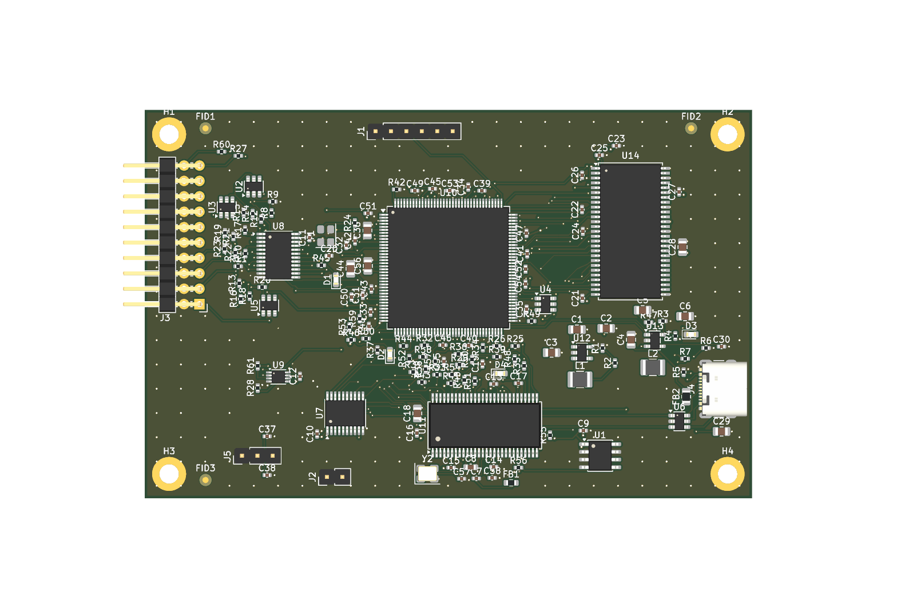

# s6la8

An open-source 8-channel logic analyzer built around a Cypress/Infineon
CY7C68013A (FX2LP) USB controller and a Xilinx Spartan-6 XC6SLX9 FPGA, with a
driver for [sigrok](https://sigrok.org).

`s6la8` is a working name.

## Status: design in progress, nothing built or tested on hardware

No board has been manufactured. No FPGA bitstream has been built. Nothing in
this repository has run on real hardware. **Do not order this board yet.**

| Part | State |
|---|---|
| Schematic (`hardware/s6la8.zen`) | Complete, 155 parts. Builds cleanly; not yet reviewed by a second person. KiCad ERC: 1 error (a stray 3.3 V power symbol the generator leaves next to `R_LED_USB`; it touches nothing and the netlist is correct) and 7 "power pin not driven" findings downgraded to warnings in the project file, because the rails are fed by regulator outputs and the generated sheet has no power flags |
| PCB layout (`hardware/eda/s6la8.kicad_pcb`) | Placed and autorouted. KiCad DRC: 0 errors, 317 warnings (315 silkscreen, 2 leftover 0.05 mm track stubs), **1 connection still open**: FPGA ground pin 54. The schematic-parity check reports only naming differences (a leading `/` and the names of no-connect nets). No signal-integrity or power-integrity review. See "Layout" below |
| FX2 firmware (`firmware/`) | Compiles with SDCC (about 3.3 KB of code). Never run |
| FPGA gateware (`gateware/`) | Streaming and a 32 K-sample triggered buffer pass simulation. No ISE build yet, so the pinout and timing are unverified. The SDRAM deep buffer is not implemented |
| libsigrok driver (`host/driver/`) | Compiles against libsigrok. Never run against a device |



The schematic is in [docs/schematic.pdf](docs/schematic.pdf). It is one very
large generated sheet and still needs to be split into readable pages.

## Design

- 8 channels through a 74LVC8T245 whose input side runs from the target's own
  supply (1.65 V to 5.5 V), with series resistors and ESD protection.
- XC6SLX9 samples, triggers (four stages, level and edge) and buffers.
- FX2LP carries data over USB 2.0 high speed in synchronous slave-FIFO mode,
  loads the FPGA bitstream (slave serial) and gives the host register access.
- 256 Mbit SDRAM footprint for a deep buffer (gateware pending).
- Fallback: a 74LVC245 copies the buffered probes onto FX2 port B, so the
  board is intended to work as a plain 24 MS/s `fx2lafw` analyzer with any
  released sigrok, with the FPGA unconfigured.

Rates implemented in gateware: up to 100 MS/s into the buffer, up to 25 MS/s
streaming. 200 MS/s is a goal, not a feature.

## Layout

The board is 100 x 64 mm, four layers (signal / GND / 3.3 V / signal). The
flow is scripted and repeatable:

```
pcb layout hardware/s6la8.zen          # sync footprints and nets (Zener)
python layout/place.py eda/s6la8.kicad_pcb     # seed placement
python layout/route.py eda/s6la8.kicad_pcb     # Freerouting
python layout/fanout.py eda/s6la8.kicad_pcb    # plane vias
python layout/patch.py dump|rip|apply ...      # leftovers, see the file header
python layout/patch_solve.py ...               # grid router with rip-up (needs numpy)
```

(`place.py`, `route.py`, `fanout.py` and `patch.py` run with KiCad's bundled
Python.)

The leftover pass is a plain grid router. It closed the connections
Freerouting left open by cutting neighbouring tracks near a boxed-in pad and
joining them again around the new copper. The tracks it lays are legal but
not pretty (many short 0.05 mm jogs), and it moved parts of `FD1`, `FD4`,
`FD7`, `FLAGA`, `SLOE`, `MODE`, `SD_BA0`, `SD_DQ1` and `SD_DQ12` without any
regard for length or impedance.

What still has to happen before this layout can be trusted:

1. Connect FPGA pin 54 (GND, bottom row) by hand in KiCad. Its only way out
   on the top layer is crossed by the 1.2 V track from pin 52 to that pin's
   decoupling capacitor, and the bottom layer underneath is a full bus, so
   there is no room for a via. It needs a few tracks pushed aside, or the
   capacitors between the FPGA and the FX2 placed with more room.
2. Build the gateware in Xilinx ISE to confirm the FPGA accepts this pinout.
3. Review the critical routes: the USB pair, IFCLK, the SDRAM bus, the buck
   converters' switching loops, decoupling placement.
4. Check every footprint against the datasheet of the exact part ordered.
5. Run the fabricator's DFM check and build prototypes.

## Building

Everything except the bitstream builds in the development container:

```
./dev.sh make -C firmware             # FX2 firmware -> firmware/build/s6la8-fx2.fw
./dev.sh make -C gateware sim lint    # simulation and lint
./dev.sh bash host/build.sh           # libsigrok with the s6la8 driver
```

On PowerShell use `.\dev.ps1` instead of `./dev.sh`.

The bitstream needs Xilinx ISE 14.7 WebPACK on an x86-64 machine (there is no
open-source place-and-route for Spartan-6):

```
make -C gateware/ise bitstream
```

The hardware is described in [Zener](https://github.com/diodeinc/pcb) and
generates a KiCad 10 project in `hardware/eda/`. `hardware/gen_pins.py`
derives the FPGA pin constraints from the schematic.

## USB identity

The firmware currently uses the pid.codes test ID `1209:0001`. That is for
development only and must be replaced by an assigned ID before any board is
distributed.

## Licenses

| Part | License |
|---|---|
| `host/driver/`, `gateware/` | GPL-3.0-or-later |
| `firmware/` | GPL-2.0-or-later (derived from sigrok-firmware-fx2lafw); bundled fx2lib is LGPL-2.1-or-later |
| `hardware/` | CERN-OHL-S-2.0 |
| `hardware/lib/` | Symbols and footprints copied from the KiCad libraries (CC-BY-SA 4.0 with the KiCad library exception) |

Full texts are in `LICENSES/`.
