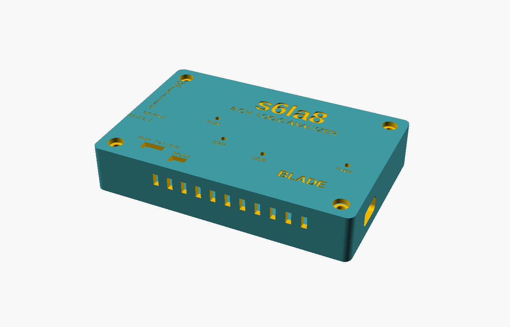

# s6la8

An open-source 8-channel logic analyzer built around a Cypress/Infineon
CY7C68013A (FX2LP) USB controller and a Xilinx Spartan-6 XC6SLX9 FPGA, with a
driver for [sigrok](https://sigrok.org).

`s6la8` is a working name.

## Status: design complete, not yet built or tested on hardware

The design files are complete and pass every check that can run without
hardware. No board has been manufactured and no bitstream has been built yet,
so **build and test prototypes before ordering a batch** (see
[docs/manufacturing.md](docs/manufacturing.md)).

| Part | State |
|---|---|
| Schematic (`hardware/s6la8.zen`) | Complete, 155 parts. KiCad ERC: 0 errors; 7 "power pin not driven" findings are downgraded to warnings in the project file because the rails are fed by regulator outputs and the generated sheet has no power flags. Not yet reviewed by a second person |
| PCB layout (`hardware/eda/s6la8.kicad_pcb`) | **Fully routed. KiCad DRC: 0 errors, 0 unconnected, 1 warning** (the probe header's silkscreen was trimmed at the board edge on purpose). Schematic parity: only naming differences. USB pair routed as a coupled 90 ohm pair. No signal- or power-integrity simulation |
| Manufacturing package (`hardware/release.py`) | Gerbers, drill, JLCPCB BOM and pick-and-place, STEP, schematic and assembly PDFs, fab notes. Refuses to build unless DRC is clean |
| Enclosure (`case/`) | Printable tray and lid (OpenSCAD), checked against KiCad's 3D model of the populated board: no collisions. Not yet printed |
| FX2 firmware (`firmware/`) | Compiles with SDCC (4.0 KB of code). Never run |
| FPGA gateware (`gateware/`) | Streaming, 32 K-sample triggered buffer and board authentication pass simulation; Verilator lint clean. **No ISE build yet**, so pinout and timing are unverified. The SDRAM deep buffer is not implemented |
| libsigrok driver (`host/driver/`) | Compiles against libsigrok. Never run against a device |
| Production tools (`tools/`) | Key generation, per-board provisioning and end-of-line test. Never run against a device |




The schematic is in [docs/schematic.pdf](docs/schematic.pdf): one large
generated sheet (2.7 x 1 m), best read zoomed in on screen.

## Design

- 8 channels through a 74LVC8T245 whose input side runs from the target's own
  supply (1.65 V to 5.5 V), with series resistors and ESD protection.
- XC6SLX9 samples, triggers (four stages, level and edge) and buffers.
- FX2LP carries data over USB 2.0 high speed in synchronous slave-FIFO mode,
  loads the FPGA bitstream (slave serial) and gives the host register access.
- 256 Mbit SDRAM footprint for a deep buffer (gateware pending).
- Fallback: a 74LVC245 copies the buffered probes onto FX2 port B, so the
  board is intended to work as a plain 24 MS/s `fx2lafw` analyzer with any
  released sigrok, with the FPGA unconfigured.

Rates implemented in gateware: up to 100 MS/s into the buffer, up to 25 MS/s
streaming. 200 MS/s is a goal, not a feature.

## Layout

The board is 100 x 64 mm, four layers (signal / GND / 3.3 V / signal). The
flow is scripted and repeatable:

```
pcb layout hardware/s6la8.zen          # sync footprints and nets (Zener)
python layout/place.py eda/s6la8.kicad_pcb     # seed placement
python layout/route.py eda/s6la8.kicad_pcb     # Freerouting
python layout/fanout.py eda/s6la8.kicad_pcb    # plane vias
python layout/patch.py dump|rip|apply ...      # leftovers, see the file header
python layout/patch_solve.py ...               # grid router with rip-up (needs numpy)
```

(`place.py`, `route.py`, `fanout.py` and `patch.py` run with KiCad's bundled
Python.)

The leftover pass is a plain grid router. It closed the connections
Freerouting left open by cutting neighbouring tracks near a boxed-in pad and
joining them again around the new copper. The tracks it lays are legal but
not pretty (many short 0.05 mm jogs), and it moved parts of `FD1`, `FD4`,
`FD7`, `FLAGA`, `SLOE`, `MODE`, `SD_BA0`, `SD_DQ1` and `SD_DQ12` without any
regard for length or impedance.

`layout/usb_pair.py` re-routes the USB pair as a coupled pair and
`layout/silk.py` sets up the production silkscreen; both can run again after
`pcb layout`.

The leftover pass is a plain grid router. It closed the connections
Freerouting left open by cutting neighbouring tracks near a boxed-in pad and
joining them again around the new copper. One pin (FPGA pin 54, GND) needed a
placement change: decoupling capacitors C40 (1.2 V) and C46 (3.3 V) swapped
places so that the 1.2 V track no longer crosses the ground pin's exit. The
grid router's tracks are legal but not pretty, and it moved parts of `FD1`,
`FD4`, `FD7`, `FLAGA`, `PKTEND`, `SLOE`, `MODE`, `SD_BA0`, `SD_DQ1` and
`SD_DQ12` without regard for length; none of these is critical at the rates
implemented.

Before ordering a batch:

1. Build the gateware in Xilinx ISE and confirm the pinout and timing.
2. Build five prototypes and run the bring-up list in
   [docs/manufacturing.md](docs/manufacturing.md).
3. Check every footprint against the datasheet of the exact part ordered.

## Copy protection

The FPGA bitstream checks that it runs on a board you provisioned:

- Every Spartan-6 has a factory-programmed, unique 57-bit Device DNA.
  (The XC6SLX9 has no bitstream encryption; only the LX75 and larger do.)
- At the end-of-line test, `tools/eol.py` reads the DNA and writes
  SipHash-2-4(key, DNA) into the EEPROM. The key is 128 bits from
  `tools/provision.py newkey` and never leaves your machine.
- A production bitstream (`make -C gateware/ise bitstream PRODUCTION=1`)
  contains the key, recomputes the hash and refuses to capture if it does
  not match. The sigrok driver says so plainly.
- A cloned board has a different DNA. Making it work needs the key, which
  means reverse-engineering the undocumented Spartan-6 bitstream format, or
  patching the check out of the bitstream. Both are possible for a determined
  expert but far beyond copying a PCB.

**Limits, and a decision for you.** This repository is published under GPL and
CERN-OHL-S, which explicitly allow anyone to build and sell copies. The open
default build (`auth_key_dev.vh`) does not enforce the check, so a cloner can
simply build their own unrestricted bitstream from this repository. The
scheme only protects your product if the production gateware and key stay
private: keep `gateware/` (you are its sole author, so you may relicense it)
and the key out of public repositories from now on, and protect the product
name with a trademark. The firmware is derived from fx2lafw and stays
GPL-2.0; the libsigrok driver stays GPL-3.0.

## Manufacturing

```
python hardware/release.py A      # -> hardware/release/revA/
```

Cost, supplier choice, import and the German legal requirements (CE, WEEE,
packaging) for a run of 100 are in [docs/manufacturing.md](docs/manufacturing.md).
The enclosure is in [case/](case/s6la8_case.scad): PETG, no supports, four
M3x12 screws into heat-set inserts.

## Building

Everything except the bitstream builds in the development container:

```
./dev.sh make -C firmware             # FX2 firmware -> firmware/build/s6la8-fx2.fw
./dev.sh make -C gateware sim lint    # simulation and lint
./dev.sh bash host/build.sh           # libsigrok with the s6la8 driver
```

On PowerShell use `.\dev.ps1` instead of `./dev.sh`.

The bitstream needs Xilinx ISE 14.7 WebPACK, which is x86-64 only (there is
no open-source place-and-route for Spartan-6). On an x86-64 machine:

```
make -C gateware/ise bitstream            # PRODUCTION=1 for the locked build
```

On an Arm machine the same build runs in an x86-64 container; see
[gateware/ise/README-docker.md](gateware/ise/README-docker.md).

The hardware is described in [Zener](https://github.com/diodeinc/pcb) and
generates a KiCad 10 project in `hardware/eda/`. `hardware/gen_pins.py`
derives the FPGA pin constraints from the schematic.

## USB identity

The firmware currently uses the pid.codes test ID `1209:0001`. That is for
development only and must be replaced by an assigned ID before any board is
distributed.

## Licenses

| Part | License |
|---|---|
| `host/driver/`, `gateware/` | GPL-3.0-or-later |
| `firmware/` | GPL-2.0-or-later (derived from sigrok-firmware-fx2lafw); bundled fx2lib is LGPL-2.1-or-later |
| `hardware/` | CERN-OHL-S-2.0 |
| `hardware/lib/` | Symbols and footprints copied from the KiCad libraries (CC-BY-SA 4.0 with the KiCad library exception) |

Full texts are in `LICENSES/`.
